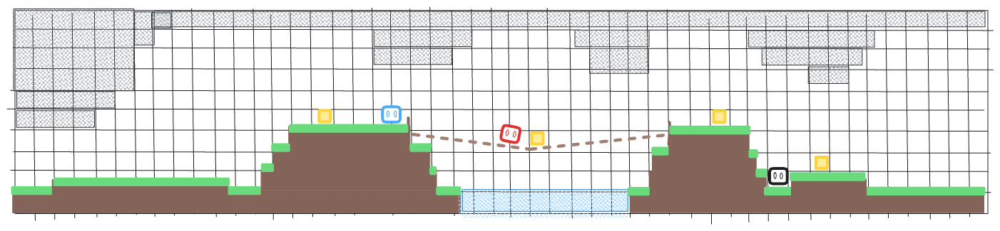

<p align="center">
  
</p>

<h1 align="center"> PitfallRelay</h1>

<p align="center">
  <strong>Learned failure experience sharing for multi-agent collaboration</strong><br />
  Can one agent’s unsuccessful interaction help a teammate avoid a similar mistake in a different situation?
</p>

<p align="center">
  <a href="#the-research-question">Research</a> ·
  <a href="#development-foundation">Development</a> ·
  <a href="#reading-the-project">Reading</a> ·
  <a href="#roadmap">Roadmap</a> ·
  <a href="#contributing">Contributing</a>
</p>

> **Research in progress.** PitfallRelay is an early research project, not a released algorithm. Literature review and the package scaffold are available. The local development foundation is initialized and passes import, configuration, and model-forward checks; the task, failure criterion, learning objectives, and message protocol remain under discussion. There are no PitfallRelay benchmark results or robot deployment claims. The banner illustrates the research vision.

## The research question

A teammate’s failure may contain useful evidence, but only if the recipient can tell **what happened, when it applies, and how to use it**. Broadcasting every bad experience can add noise or transfer advice that does not fit another agent’s situation.

PitfallRelay studies learned representations of unsuccessful interactions and their use in a recipient’s decisions during execution. The intended representation is neural; a world model, an LLM, or natural-language messages are not prerequisites. The target deployment setting allows memory and policy inputs to change without requiring an optimizer update; the exact within-episode or cross-episode protocol is still open.

<table>
<tr>
<td width="33%" align="center"><br /><strong>Represent experience</strong><br /><sub>Observations, actions, and outcomes — with an explicit failure criterion.</sub></td>
<td width="33%" align="center"><br /><strong>Match the recipient</strong><br /><sub>Distinguish relevant experience from misleading or unrelated history.</sub></td>
<td width="33%" align="center"><br /><strong>Use it in execution</strong><br /><sub>Help a teammate act in related, not necessarily identical, circumstances.</sub></td>
</tr>
</table>

These are research questions, not three completed modules or separate novelty claims. Predicting an adverse outcome does not by itself establish its cause, and an episode ending does not by itself mean failure.

## Development foundation

The selected foundation for initialization is **Conda + PyTorch + BenchMARL/TorchRL + recurrent MAPPO**. This selects the training infrastructure; it does not lock the proposed experience-sharing method.

| Layer | Role |
| :--- | :--- |
| Conda | Isolated, reproducible project environment |
| PyTorch | Policies, learned experience representations, and gradient inspection |
| BenchMARL / TorchRL | Collection, optimization, evaluation, logging, and checkpoints |
| Recurrent MAPPO | Candidate reference policy for partially observed cooperative tasks |
| PitfallRelay components | Experience representation, recipient relevance, and message use — **not implemented yet** |

Start with the [development guide](docs/development.md) and [initialization report](docs/initialization-report.md) for validated setup commands, exact dependency versions, platform coverage, and outstanding limitations. The stack has been checked on macOS arm64; Linux/CUDA and the training loop remain unverified.

BenchMARL dependency constraints must be resolved together with PyTorch and TensorDict. Its dependency declaration includes PyAV even when a particular experiment does not record video. See the [stack assessment](docs/base-stack-candidates.md) for the static review and the initialization report for actual validation.

### Quick start

```bash
scripts/create_env.sh
conda run -n pitfall-relay python -m pytest tests -q
```

The verified local stack uses Python 3.11, PyTorch 2.10.0, TorchRL 0.11.1, TensorDict 0.11.0, and BenchMARL 1.5.2. The tested platform-specific dependency set is recorded in `requirements/stack-lock.txt`; see the development guide before setting up another platform.

For a bare checkout without the research stack:

```bash
PYTHONPATH=src python3 -m unittest discover -s tests -v
```

Without the research stack, only the package test runs and stack checks are skipped. In the initialized environment, the suite also checks configuration and model-forward paths. Neither verifies learning or task performance. Training compute belongs on the separately authorized experiment host; no benchmark or training command is advertised before it is implemented and validated.

## Reading the project

| Entry | What it contains |
| :--- | :--- |
| [Research brief](docs/research-brief.md) | Initial scope, candidate question, and experimental decision gates |
| [Literature review](docs/literature/README.md) | Screening matrix, evidence levels, paper cards, and access limitations |
| [Mechanism support](docs/literature/mechanism-support-matrix.md) | Failure definition, recipient applicability, and communication efficiency |
| [Candidate methods](docs/literature/candidate-method-briefs.md) | Alternatives for discussion, **not an implementation specification** |
| [Development foundation](docs/base-stack-candidates.md) | Framework alternatives, provenance, and dependency considerations |

The review is a working research artifact, not a systematic or exhaustive survey. Some readings are partial and some conclusions remain provisional. Novelty is not established by an unfilled cell in a literature matrix.

### Selected related work

| Work | Why it matters here |
| :--- | :--- |
| [MAPPO](https://arxiv.org/abs/2103.01955) | Cooperative policy optimization and reference implementation practices |
| [FEMA](https://arxiv.org/abs/2603.07110) | Failure episodic memory and repeated-failure avoidance |
| [Memory-driven communication](https://link.springer.com/article/10.1007/s10994-019-05864-5) | Learned read/write communication through shared memory |
| [TarMAC](https://proceedings.mlr.press/v97/das19a.html) | Targeted messages and recipient-dependent aggregation |
| [SUPER](https://arxiv.org/abs/2311.00865) | Selective sharing of training experiences and its limits |
| [MemCo](https://arxiv.org/abs/2610.07376) | Reusing other agents’ experience across interactive environments |
| [RAVEN](https://arxiv.org/abs/2609.37566) | Receiver-conditioned, task-oriented finite-alphabet communication |
| [CooT](https://arxiv.org/abs/2506.23549) | Coordination from context without deployment-time parameter updates |

These works provide mechanisms, comparisons, and overlap checks. They are not all code dependencies or required reproductions. Recent preprints should be read with their evidence and publication status in mind.

## Evaluation principles


- **Task utility:** report team success and repeated adverse outcomes, not just auxiliary losses.
- **Recipient relevance:** measure both helpful transfers and harm from irrelevant experience.
- **Fair comparisons:** align execution-time information access, training budgets, and model capacity where needed.
- **Communication cost:** distinguish payload size, message frequency, encoding/retrieval latency, and training cost.
- **Traceability:** preserve code revision, configuration, seeds, step units, checkpoint selection, and raw evaluation outputs.

Negative and inconclusive results remain part of the record. A learned module receiving gradients is engineering evidence; it is not evidence of successful experience transfer.

## Roadmap

| Stage | Current state | Exit criterion |
| :--- | :--- | :--- |
| Literature and foundation review | Materials available; interpretation continues | Read core work and identify a defensible, testable question |
| Local infrastructure | Verified on macOS arm64 | Isolated Conda environment; import, config, and model-forward checks pass |
| Remote and training validation | Not started | Linux/CUDA setup and sample → update → evaluation → recovery checks |
| Problem specification | Open | Agree on failure, recipient information, supervision, task, and controls |
| Minimal implementation | Not started | Verified experience/message path and a learnable reference task |
| Controlled experiments | Not started | Compare against fair baselines under a registered budget |

There is no public release date or promised performance target.

## Repository layout

```text
src/pitfall_relay/   Project package
tests/             Lightweight checks
docs/
   assets/          User-provided banner, SVG logo, and icon set
   literature/      Evidence matrix and related-work analysis
   research-brief.md
   base-stack-candidates.md
```

Pinned dependencies are in `requirements/`, setup tools in `scripts/`, and CI configuration in `.github/workflows/`. See the development guide for details.

## Contributing

This repository is still defining its first experiment. Useful contributions include reproducible issue reports, literature corrections with primary sources, and focused engineering proposals. Discuss task or algorithm changes before implementing them.

- Keep changes scoped and preserve unrelated work.
- Report what was actually tested and on which platform.
- Keep credentials, datasets, checkpoints, and run outputs out of Git.
- Obtain approval for experiment budgets and remote execution.

See [working rules](AGENTS.md) before making changes. Existing discussions and plans are not blanket permission to launch training.

## Acknowledgments and licensing

The development foundation builds on [PyTorch](https://github.com/pytorch/pytorch), [TorchRL](https://github.com/pytorch/rl), [BenchMARL](https://github.com/facebookresearch/BenchMARL), and the [MAPPO reference implementation](https://github.com/marlbenchmark/on-policy). Respect each upstream project’s license when reusing code.

A license for PitfallRelay itself has not been selected. Public presentation does not grant an open-source license; reuse terms will be documented before a formal release. The banner was supplied by the project owner; the SVG logo and icons were authored for this repository. Asset reuse terms follow the eventual project license and any applicable third-party rights. There is no associated PitfallRelay paper or citation entry yet.
